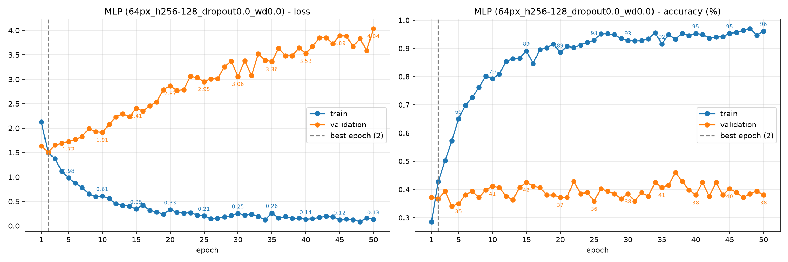
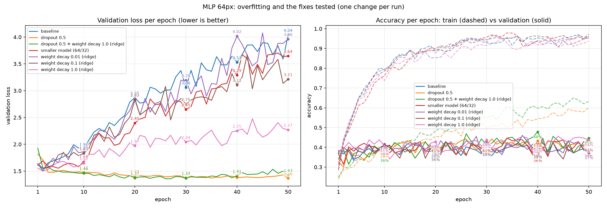
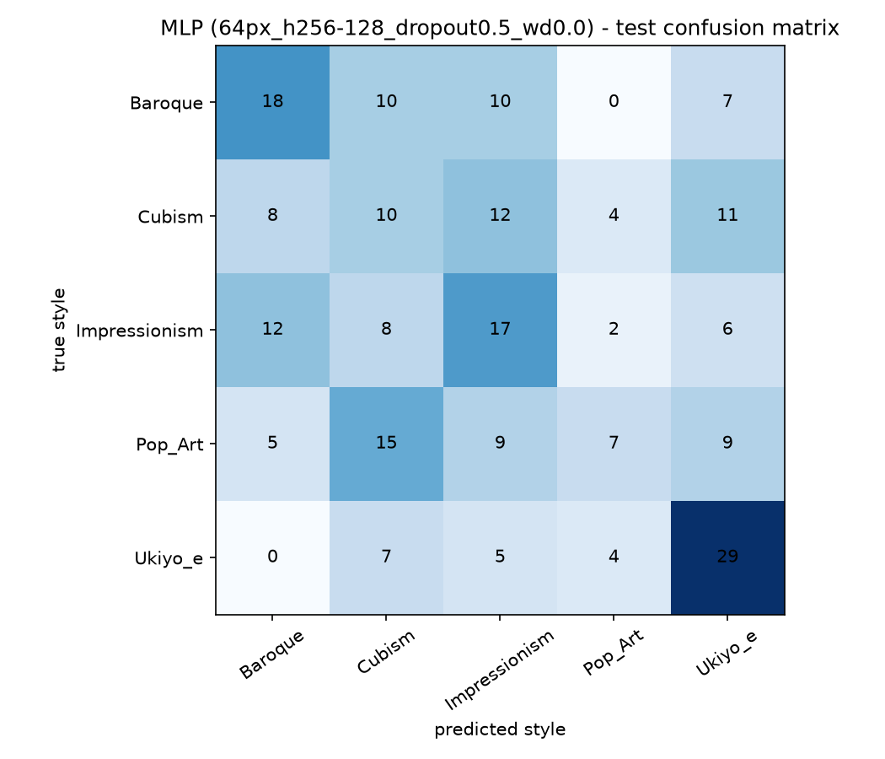

# MLP: training monitoring and failure diagnosis

Integrated from Viviam's `vivi` branch at commit `55a86d5`. These are historical
experiments on the 1,049/226/225 split. The integrated runner uses 1,050/225/225;
the 36.0% test result below must not be presented as a fresh common-protocol run.
Figure paths and wording about checkpoint selection and experimental evidence
have been clarified during integration; the numerical results are unchanged.

**Deliverable:** "Training monitoring and failure diagnosis" for the feed-forward network (MLP).
**Model:** `WikiArtMLP` (`src/wikiart/model.py`): flatten → Linear(12,288 → 256) → ReLU → Linear(256 → 128) → ReLU → Linear(128 → 5).
**Data:** 5 styles × 300 images, 64×64 px, stratified split 1,049 train / 226 validation / 225 test (seed 0).
**Training:** AdamW, lr 1e-3, batch 32, 50 epochs, cross-entropy. The weights of the epoch with the lowest validation loss are kept. All 50 epochs run; this is best-checkpoint selection, without an early termination of training.

## 1. Monitoring: the symptom

| | Epoch 2 (best) | Epoch 50 |
|---|---|---|
| Train accuracy | 42.8% | 96.2% |
| Validation accuracy | 36.7% | 38.1% |
| Validation loss | 1.506 | 4.039 |

The training curves keep improving until the end: train accuracy reaches 96% and train loss falls close to 0. The validation curves do not follow: validation accuracy stays around 37–40%, and validation loss is lowest at epoch 2, then rises to 4.0. The model gets better on the images it trains on and worse on new images, and it becomes more and more confident in its wrong predictions. This is the classic symptom of **overfitting**: train loss goes down while validation loss goes up.

## 2. Diagnosis: the cause

- Parameters: **3,179,525**, of which 12,288 × 256 = 3,145,728 in the first layer alone.
- Training images: **1,049**, so about **3,000 parameters per training image**.

The MLP flattens each 64×64 colour image into 12,288 numbers and connects every one to the 256 neurons of the first layer. Its capacity relative to the small training set is a plausible contributor to overfitting. The curves show a strong training/validation divergence; the parameter-to-image ratio alone does not prove memorisation or identify its sole cause.

## 3. Fixes tested (one change per run)

Individual fixes change one setting relative to baseline; the combination run changes both dropout and weight decay. The data, split, seed, optimiser and epoch budget remain fixed. Runs are compared on **validation**. The **final gap** (train accuracy − validation accuracy at epoch 50) and **final validation loss** are descriptive indicators, not statistical tests of overfitting.

**Dropout 0.5.** Hidden activations are independently disabled with probability 0.5 during training. This reduces reliance on specific activations. Among the individual fixes tested, it gives the clearest reduction in the recorded divergence: the final gap falls from 58 to 16 points and the final validation loss is about 1.37 instead of 4.0. Validation accuracy at the selected epoch improves from 36.7% to 44.7%. This does not prove that all overfitting has been eliminated.

**Decoupled weight decay (AdamW).** This shrinks weights during optimizer steps; it should not be equated exactly with a ridge/L2 penalty under adaptive optimization. With lr 0.001 and decay 0.01, its direct per-step multiplier is 0.99999. The 0.01 and 0.1 experiments retain substantial train/validation divergence. At 1.0, the final validation loss falls to 2.27 versus 4.04 for baseline, while final train accuracy remains about 94%. The observations show a partial improvement in this run, without isolating a unique mechanism.

**Smaller model (64/32 neurons).** Reducing the hidden layers cuts the parameter count to 788,741, about a quarter of baseline. The final gap remains about 57 points and the final validation loss is 3.645: this capacity reduction did not remove the recorded divergence. Its parameter count alone does not prove why.

**Dropout 0.5 + weight decay 1.0.** The combination has a slightly lower minimum validation loss (1.357 vs 1.365) but lower accuracy at that selected epoch (42.9% vs 44.7%). These two single-seed runs do not establish statistical equivalence or prove that weight decay adds no benefit.

**Checkpoint selection** keeps the weights of the minimum validation-loss epoch. Baseline's reported model therefore comes from epoch 2, before the later divergence. Training itself still runs for 50 epochs.

**Choice of the final model.** Viviam retained **dropout 0.5 alone** as the simpler configuration, with higher selected-epoch validation accuracy despite the combination's slightly lower validation loss. This is a deliberate simplicity/quality trade-off, not an automatic global minimum-loss choice. One validation image represents about 0.44 percentage points; that fact alone does not establish a significance threshold or prove the differences are noise.

## 4. Test result of the selected configuration

| | Test accuracy |
|---|---|
| Baseline (no dropout) | 31.1% |
| **Final MLP (dropout 0.5)** | **36.0%** |

| Style | Recall |
|---|---|
| Ukiyo-e | 64% (29/45) |
| Baroque | 40% (18/45) |
| Impressionism | 38% (17/45) |
| Cubism | 22% (10/45) |
| Pop Art | 16% (7/45), 15 predicted as Cubism |

The observed test accuracy improves by 4.9 points over baseline (31.1% → 36.0%). This is one measured gain on the held-out examples, not proof of a stable gain across seeds. Selection among seven validation runs may contribute to optimistic validation performance, and sampling variability may also contribute to the validation/test gap. These explanations were not isolated experimentally. Baseline and earlier resolution experiments already included test evaluations, so the test was not globally untouched throughout the project.

The confusion matrix shows uneven recall: Ukiyo-e is the best recognised style (64%), while Pop Art and Cubism are lowest (16% and 22%). Fifteen Pop Art examples are predicted as Cubism. A reliance on color features is a possible explanation, but no feature analysis or ablation demonstrates it. Flattening preserves all input pixel values and their fixed positions; it does not provide the local structure and weight-sharing bias of convolutions.

## 5. Conclusion

Dropout substantially reduces the observed divergence, but the selected MLP still obtains only 36% test accuracy. Its training accuracy of about 60% is measured with dropout active and is not the accuracy of a deterministic evaluation of the final model on train. The study motivates comparing convolutional approaches, which explicitly exploit local image structure. It does not establish architecture as the sole limiting factor or prove that another dense configuration could not improve the score.

## 6. Limitations

- One seed and one split: results could vary by a few points with another split.
- Small validation and test sets (226 / 225 images): no formal significance analysis or confidence intervals were computed; there is no established universal three-point threshold.
- The split is by image, not by artist: paintings by the same artist can appear in both train and test.
- Train accuracy is measured with dropout and augmentation active, during weight updates; it is not directly comparable to deterministic validation accuracy.
- Dropout's best epoch was the last one (50): it might improve slightly with more epochs.

## Reproduce

These commands now use the integrated code and the common 1,050/225/225
split. They create new runs rather than exactly reproducing the historical
split. Choose new output paths when a configuration has already been run.
The comparison command below defaults to the historical summaries stored
directly in `reports/mlp`; use `--run-dirs` for explicit integrated run folders.

    python -m wikiart.train_mlp                                    # baseline
    python -m wikiart.train_mlp --dropout 0.5                      # dropout
    python -m wikiart.train_mlp --weight-decay 1.0                 # ridge (also 0.01, 0.1)
    python -m wikiart.train_mlp --hidden1 64 --hidden2 32          # smaller model
    python -m wikiart.train_mlp --dropout 0.5 --weight-decay 1.0   # combination
    python -m wikiart.compare_mlp                                  # table + curves
    python -m wikiart.train_mlp --dropout 0.5 --test               # final test (once)
