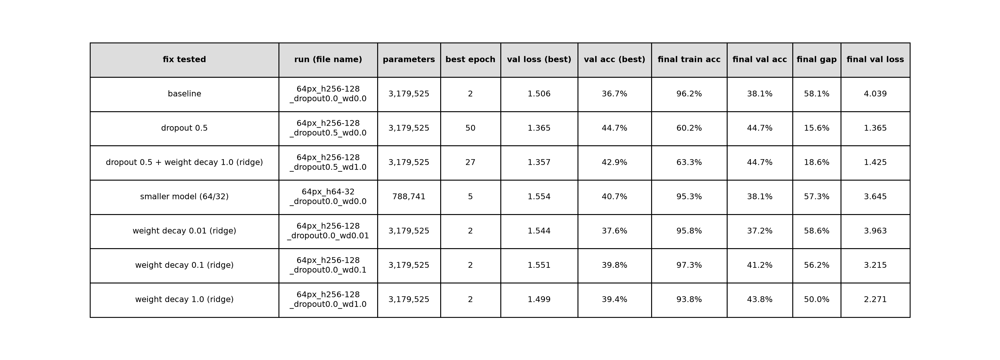

# MLP: training monitoring and failure diagnosis

**Deliverable:** "Training monitoring and failure diagnosis" for the feed-forward network (MLP).
**Model:** `WikiArtMLP` (`src/wikiart/model.py`): flatten → Linear(12,288 → 256) → ReLU → Linear(256 → 128) → ReLU → Linear(128 → 5).
**Data:** 5 styles × 300 images, 64×64 px, stratified split 1,049 train / 226 validation / 225 test (seed 0).
**Training:** AdamW, lr 1e-3, batch 32, 50 epochs, cross-entropy. The weights of the epoch with the lowest validation loss are kept (early stopping).

## 1. Monitoring: the symptom

| | Epoch 2 (best) | Epoch 50 |
|---|---|---|
| Train accuracy | 42.8% | 96.2% |
| Validation accuracy | 36.7% | 38.1% |
| Validation loss | 1.506 | 4.039 |

The training curves keep improving until the end: train accuracy reaches 96% and train loss falls close to 0. The validation curves do not follow: validation accuracy stays around 37–40%, and validation loss is lowest at epoch 2, then rises to 4.0. The model gets better on the images it trains on and worse on new images, and it becomes more and more confident in its wrong predictions. This is the classic symptom of **overfitting**: train loss goes down while validation loss goes up.

## 2. Diagnosis: the cause

- Parameters: **3,179,525**, of which 12,288 × 256 = 3,145,728 in the first layer alone.
- Training images: **1,049**, so about **3,000 parameters per training image**.

The MLP flattens each 64×64 colour image into 12,288 numbers and connects every one of them to each of the 256 neurons of the first layer. With about 3,000 parameters per training image, the network has enough capacity to memorise the individual training paintings instead of learning what characterises each style. A model that memorises fits the training set almost perfectly but does not generalise, which is exactly what the curves show.

## 3. Fixes tested (one change per run)

Each run changes **one** setting; everything else is identical (same data, split, seed, optimiser, epochs). Runs are compared on **validation** only. The overfitting is measured by the **final gap** (train accuracy − validation accuracy at epoch 50) and the **final validation loss**.

**Dropout 0.5.** During training, each hidden neuron is switched off with probability 0.5, so the network cannot rely on any single neuron and has to learn redundant features. It is the only fix that stops the overfitting: the final gap falls from 58 to 16 points, and the validation loss stays flat at about 1.37 instead of rising to 4.0. Validation accuracy at the best epoch improves from 36.7% to 44.7%.

**Weight decay / ridge (L2).** Weight decay penalises large weights, which keeps the learned function smoother. Its effect depends on its strength: at 0.01 it changes nothing, because in AdamW each step multiplies the weights by 1 − lr × wd = 1 − 0.001 × 0.01 = 0.99999, far too weak over 1,650 steps. At 0.1 the effect is small; at 1.0 it slows the overfitting (final validation loss 2.27 instead of 4.04), but the model still reaches 94% train accuracy: it memorises more slowly, it does not stop.

**Smaller model (64/32 neurons).** Reducing the hidden layers divides the parameters by 4 (788,741). Overfitting remains (gap 57 points), because the model still has about 750 parameters per training image, which is still enough to memorise.

**Dropout 0.5 + ridge 1.0.** The combination is equivalent to dropout alone on validation (loss 1.357 vs 1.365, accuracy 42.9% vs 44.7%). Adding ridge brings no measurable improvement: dropout does the work.

**Early stopping** is already part of the training code: the weights of the epoch with the lowest validation loss are kept. This is why the baseline's reported model comes from epoch 2, before the overfitting starts.

**Choice of the final model.** Dropout 0.5 alone and dropout 0.5 + ridge 1.0 are equivalent on validation: their differences are within noise (one validation image = 0.44%). We keep **dropout 0.5 alone**, the simpler model with fewer hyperparameters.

## 4. Final result (test set, used once)

| | Test accuracy |
|---|---|
| Baseline (no dropout) | 31.1% |
| **Final MLP (dropout 0.5)** | **36.0%** |

| Style | Recall |
|---|---|
| Ukiyo-e | 64% (29/45) |
| Baroque | 40% (18/45) |
| Impressionism | 38% (17/45) |
| Cubism | 22% (10/45) |
| Pop Art | 16% (7/45), 15 predicted as Cubism |

Dropout improves the test accuracy by 4.9 points (31.1% → 36.0%), so the gain holds on images the model has never seen. The test score is lower than the validation score (44.7%) because the final configuration was chosen among seven runs on validation, which makes that score optimistic; with 225 test images, one measurement can also vary by a few points. The test score is the one we report.

The confusion matrix shows very uneven results. Ukiyo-e, whose flat areas and distinctive palette make it recognisable from colours, is the best recognised style (64%). Pop Art and Cubism, defined by shapes and composition, are the worst (16% and 22%), and Pop Art is mostly confused with Cubism. This is consistent with an MLP that relies on colour information rather than on shapes, which the flatten cannot preserve.

## 5. Conclusion

Dropout fixes the overfitting, but not the accuracy. Even when it can no longer memorise, the MLP reaches only about 60% on the training set and 36% on the test set: it cannot extract the features that define a style. The limit is therefore the architecture itself. Flattening the image into a vector destroys its two-dimensional structure (which pixels are neighbours), and brushstrokes, shapes and composition depend on that structure. Regularisation cannot give this information back, which motivates convolutional networks, designed to exploit the image structure (our CNN and the pretrained ResNet).

## 6. Limitations

- One seed and one split: results could vary by a few points with another split.
- Small validation and test sets (226 / 225 images): differences under about 3 points are not meaningful.
- The split is by image, not by artist: paintings by the same artist can appear in both train and test.
- Train accuracy with dropout is measured with dropout active, so it slightly underestimates the model.
- Dropout's best epoch was the last one (50): it might improve slightly with more epochs.

## Reproduce

    python -m wikiart.train_mlp                                    # baseline
    python -m wikiart.train_mlp --dropout 0.5                      # dropout
    python -m wikiart.train_mlp --weight-decay 1.0                 # ridge (also 0.01, 0.1)
    python -m wikiart.train_mlp --hidden1 64 --hidden2 32          # smaller model
    python -m wikiart.train_mlp --dropout 0.5 --weight-decay 1.0   # combination
    python -m wikiart.compare_mlp                                  # table + curves
    python -m wikiart.train_mlp --dropout 0.5 --test               # final test (once)